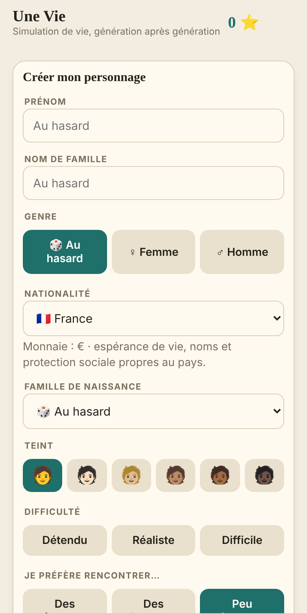
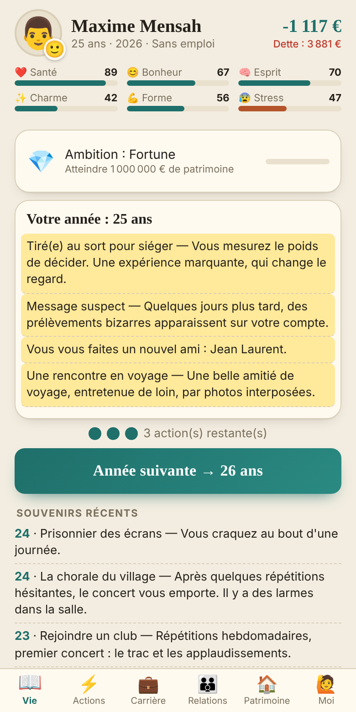
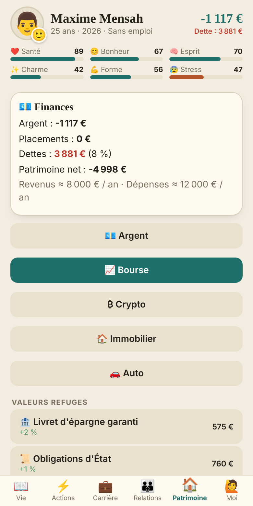
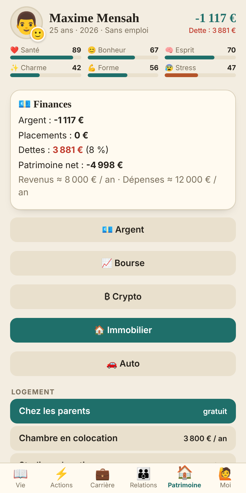

# Une Vie

**Simulation de vie réaliste, année après année — gratuite, sans pub, en français et en anglais.**

[▶️ Jouer dans le navigateur](https://obedhounon-sudo.github.io/Une-vie/) · [📱 Télécharger l'APK Android](../../releases/latest) · [☕ Soutenir le jeu](https://buymeacoffee.com/obedhounonl)

   

## Le jeu

Chaque année, vous avez **3 actions**, des événements bouleversent votre personnage, et vos choix façonnent sa santé, son bonheur, sa carrière, ses relations et sa fortune. À sa mort, ses héritiers reprennent le flambeau avec son patrimoine.

## Fonctionnalités

- 🌍 **15 pays**, nom et nationalité au choix, monnaie locale
- 🧬 Traits de personnalité, ambitions de vie, **30 succès**
- 🎓 École, études, **20+ métiers** avec promotions et retraite
- ❤️ Amis, amours, mariage, enfants, **héritage de la fortune**
- 📈 **Bourse, cryptomonnaies, immobilier locatif** (cours inspirés de l'histoire réelle, krachs inclus)
- 🏠 Plus de 20 logements, 🚗 12 voitures, permis de conduire, animaux
- 🚔 Prison, justice, actions risquées
- ⏪ Machine à remonter le temps ; ⚡ mode Dieu (débloquable avec un don de 1 $)
- 550 événements, sauvegarde automatique, export/import de partie

## Jouer

| Où | Comment |
|---|---|
| Navigateur (téléphone ou ordinateur) | [obedhounon-sudo.github.io/Une-vie](https://obedhounon-sudo.github.io/Une-vie/) |
| Android | Ouvrez la [dernière version](../../releases/latest), téléchargez l'APK, autorisez « sources inconnues » |

## English

**Une Vie** is a realistic, very long life simulator: school, careers, love, family, stocks, crypto, real estate, and heirs who inherit your fortune. 15 countries, French and English, free, no ads. [Play in your browser](https://obedhounon-sudo.github.io/Une-vie/) or grab the Android APK from [Releases](../../releases/latest).

## Technique

Jeu en un seul fichier HTML/CSS/JS (`index.html`), emballé en application Android avec Capacitor. Une GitHub Action compile l'APK à chaque mise à jour et le publie dans les Releases. Voir aussi la [politique de confidentialité](confidentialite.html) : aucune donnée n'est collectée, tout reste sur votre appareil.

## Soutenir

Le jeu est gratuit. Si vous l'aimez, un [petit don](https://buymeacoffee.com/obedhounonl) aide à ajouter de nouveaux pays et événements.
